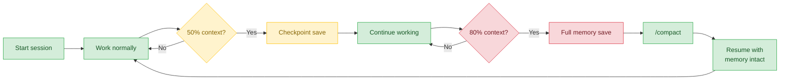
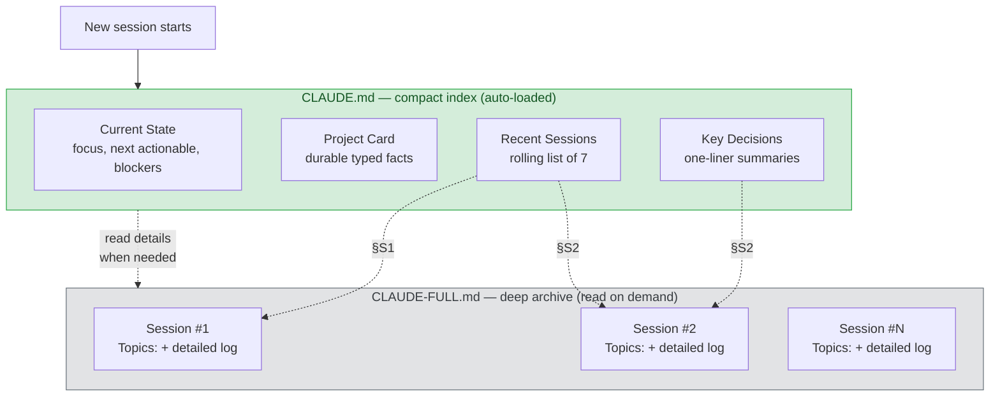
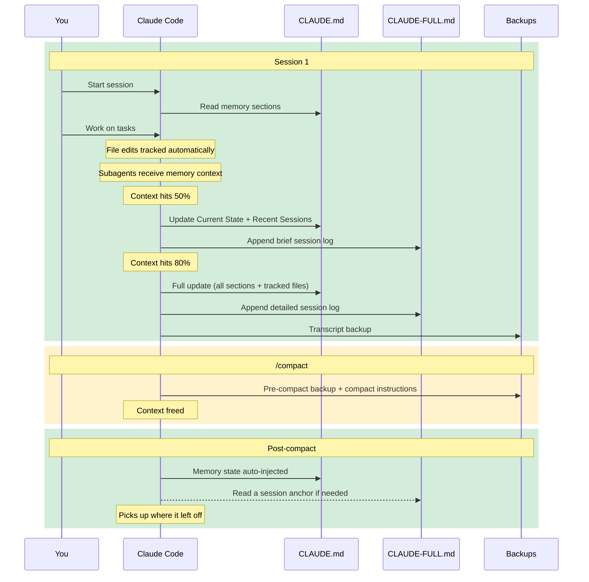
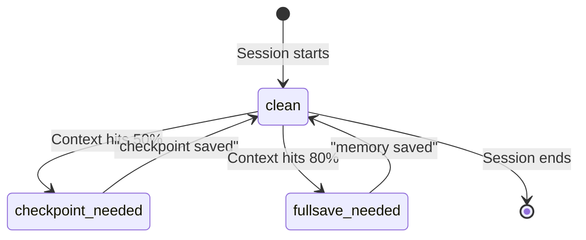

# mimo


Hook-based memory system for [Claude Code](https://docs.anthropic.com/en/docs/claude-code). Claude Code forgets everything between sessions — mimo fixes that with automatic checkpoints, a two-tier archive, and zero configuration.



## What it does

- **Automatic memory saves** — checkpoints at 50% context, full save at 80%. Claude writes session state to disk before context is lost, then resumes the interrupted task automatically
- **Reconciled, not appended** — saves update existing entries in place, supersede reversed decisions (`[superseded …]`), suppress duplicates, and durability-gate the index so it never fills with stale SHAs and finished to-dos
- **Two-tier archive** — compact index in `CLAUDE.md` (auto-loaded every session) + detailed logs in `CLAUDE-FULL.md` (read on demand)
- **Multi-project safe** — run 3+ Claude Code sessions simultaneously with fully isolated state per session
- **Subagent awareness** — subagents automatically receive session state and context % so they share the parent session's memory
- **File change tracking** — modified files are tracked per-session and included in save instructions so nothing is missed
- **Post-compact recovery** — memory state is automatically injected after compaction without extra tool calls
- **Auto-update notifications** — checks for new versions once per day (background, never blocks). Run `mimo update` when notified
- **Zero configuration** — install once, start a session, mimo auto-initializes everything. Use `/save` anytime to save manually

## Quick start

1. Install mimo (one command)
2. `cd` into any project and start Claude Code
3. mimo auto-creates `CLAUDE.md` and `CLAUDE-FULL.md`
4. Work normally — the status bar tracks context usage with a colored progress bar
5. At 50%, Claude saves a checkpoint. At 80%, a full session log
6. Start a new session — Claude reads the memory sections and picks up where you left off
7. Use `/save` or `/save-full` anytime to save on demand

## Install

```bash
curl -fsSL https://raw.githubusercontent.com/ShivanDana/mimo/main/install.sh | bash
```

Or install from a local clone (no network required):

```bash
git clone https://github.com/ShivanDana/mimo && bash mimo/install.sh
```

The installer copies mimo's source files (hooks, skills, CLI, uninstaller) into `~/.claude` and `~/.local/bin` — the repo files are the single source of truth. When piped from `curl`, it downloads the matching release tarball first; from a clone, it installs those local files directly.

**Requirements:** `jq`, `bash` 3.2+, [Claude Code](https://docs.anthropic.com/en/docs/claude-code) installed

Verify the installation:

```bash
mimo status
```

## How it works

### Two-tier memory



`CLAUDE.md` entries reference sessions in `CLAUDE-FULL.md` by **anchor** (e.g., `[CLAUDE-FULL.md §S12]`). Each session is a heading `## S<N> — YYYY-MM-DD — <slug>` and opens with one `Topics: files=…; systems=…; decisions=…` index line — grep is the only retrieval, so this curated line is the grep target that lands recall on the right anchor. Claude locates a session with `grep -n '^## S' CLAUDE-FULL.md` and reads from that line — no need to load the whole archive. Anchors don't rot when the archive is edited, unlike the line ranges older versions used. Run `mimo sessions` to list every anchor in the current project.

Between the fast-moving **Current State** and the episodic Recent Sessions sits the **Project Card** — a durable "what I know about this project" tier. Every line is a typed fact with an allowed prefix (`STACK`, `CONVENTION`, `ENTRYPOINT`, `TOOL-RULE`, `FAILURE-LESSON`, `RELATIONSHIP`, `INSTRUCTION`), it holds only facts that will still be true next quarter, and a full save re-emits it whole and deduplicated so it self-cleans. Current State itself is a small schema — `Focus`, a **verbatim** `Next actionable` (the user's exact latest request), live `Blockers`, and a STALE-fenced `Carried-over` for parked threads; the injected read rule is "act only on Next actionable, treat Carried-over as reference unless the user re-asks."

When a decision changes, the old index line is marked `[superseded YYYY-MM-DD → §S12]` rather than deleted, and the reversal is written as one arc ("Originally X; changed to Y because Z"). The reading rule, injected into every session's context, is **latest-wins**: when two entries disagree the later date wins, a `[superseded]` line is history rather than current guidance, and a conflict that dates can't resolve surfaces both. Superseded lines are swept into their `§S<N>` archive entry on the next full save (invalidate-then-archive), so the index stays current while history is preserved.

### Session lifecycle



### Threshold behavior



The status line tracks context window usage in real time:

```
████████░░░░░░░░░░░░ 40%  │ Claude Opus 4.6 │ $0.53     (green — normal)
██████████████░░░░░░ 52% * │ Claude Opus 4.6 │ $1.20     (yellow — checkpoint needed)
████████████████████ 83% ! │ Claude Opus 4.6 │ $2.41     (red — full save needed)
```

- **50%** — checkpoint: Claude saves current state (quick snapshot)
- **80%** — full save: Claude writes a comprehensive session log

The stop hook blocks Claude from ending a turn until the required save is complete.

**Verified saves.** The stop hook does not take Claude's word for it. When a threshold is crossed it records the request time and blocks; on the next stop it confirms the save actually happened by checking that `CLAUDE.md`'s modification time advanced past the request time (a phrase like "checkpoint saved" is accepted as a secondary signal). Only then are the done flags set. A crashed or skipped save is retried once; if the second attempt still shows no write, mimo gives up and lets the session continue rather than blocking forever. Evidence, not trust.

**Reconciled writes.** A save doesn't just append. Before writing to the index, each new fact is classified against the existing entries — duplicate (skip), more-specific update (edit the line in place), contradiction (mark the old line `[superseded …]` and add the new one), or genuinely new (add) — so the index never accumulates duplicates or two conflicting "current" facts. A **durability gate** keeps the always-loaded index lean: only facts that will still matter in a month go in, while transient details (commit SHAs, PR numbers, file counts, "phase N done") stay in the detailed `CLAUDE-FULL.md` log. If nothing durable happened, the save records "(no durable learnings)" rather than manufacturing a decision. At more than 10 Key Decisions, mimo consolidates by merit — merging and evicting the lowest-value entries — instead of dropping the oldest.

### Slash commands

Use these inside Claude Code at any time — no need to wait for automatic thresholds:

| Command | Scope | When to use |
|---------|-------|-------------|
| `/save` | Quick checkpoint | Preserve current state before a big change or context-heavy operation |
| `/save-full` | Comprehensive save | End-of-session save with full detail, or before running `/compact` |
| `/pcompact` | Compact prep | Generate context-preserving instructions to pass to `/compact` |

These are Claude Code skills installed by mimo to `~/.claude/skills/` and auto-discovered as slash commands.

### Auto-initialization

On session start, mimo can auto-create `CLAUDE.md` and `CLAUDE-FULL.md`. This is gated by the `AUTO_INIT` config key:

- **`git-only`** (default) — auto-init only inside a git working tree (covers worktrees and subdirectories). Non-git scratch directories are left untouched.
- **`always`** — auto-init in any directory.
- **`never`** — never auto-init; run `mimo init` manually where you want memory.

A **hard `$HOME` guard** applies in every mode: mimo will never auto-create a `CLAUDE.md` in your home directory, because a file there loads into *every* Claude Code session (cross-project contamination). When auto-init is skipped and no `CLAUDE.md` exists, mimo injects a one-line hint to run `mimo init`.

A freshly created `CLAUDE.md` contains the title, a one-line description, and the four Memory sections — schema'd Current State, an empty Project Card, Recent Sessions, and Key Decisions — nothing else. Set `WORKFLOW_BLOCK=on` (or run `mimo init --with-workflow`) to also include the opinionated "Workflow Orchestration" block. If a `CLAUDE.md` already exists, mimo only **appends** the memory sections and never rewrites the top of your file. Existing projects on the older layout migrate organically: the next `/save-full` rewrites a free-form Current State into the schema and creates the Project Card — hooks never rewrite your files. Idempotent — running twice produces the same result.

`CLAUDE-FULL.md` is created as an empty deep archive.

`mimo init` works in any directory except `$HOME` (use `mimo init --force-home` to override that refusal).

### Hook reference

mimo installs 9 hooks into Claude Code's hook system:

| Hook | Event | What it does |
|------|-------|-------------|
| `statusline-memory.sh` | StatusLine | Colored progress bar with context %, model, cost, threshold indicators. Writes per-session state |
| `session-start.sh` | SessionStart (startup/resume) | Creates per-session state, auto-inits project files, injects memory context, exports env vars via `CLAUDE_ENV_FILE`, cleans up dead-session state (no heartbeat in 2h) and orphaned temp files |
| `session-start-compact.sh` | SessionStart (compact) | Lightweight context reminder after compaction, writes post-compact flag for context recovery |
| `memory-gate.sh` | Stop | Blocks Claude from stopping until memory save is complete. Includes tracked file list in save instructions, then instructs Claude to resume |
| `precompact-save.sh` | PreCompact | Backs up full transcript + generates human-readable summary + outputs custom compact instructions |
| `session-end-backup.sh` | SessionEnd | Final transcript backup, cleans up session state file, changes log, and post-compact flag |
| `subagent-context.sh` | SubagentStart | Injects "Memory — Current State", the "Memory — Project Card" durable facts, and context % into subagent context |
| `user-prompt-context.sh` | UserPromptSubmit | One-shot post-compact context recovery — injects memory state on first prompt after compaction (zero overhead normally) |
| `track-changes.sh` | PostToolUse (Write\|Edit\|NotebookEdit) | Async file change tracker — appends modified file paths to per-session log |

## CLI

```bash
mimo status      # Diagnostic: hooks, skills, settings, dependencies, active/stale sessions
mimo doctor      # Deep diagnostics — settings registrations, statusLine, config, version, orphans, PATH
mimo sessions    # List CLAUDE-FULL.md session anchors in the current project
mimo init        # Re-initialize memory files in current project
mimo cleanup     # Remove stale session state, orphaned temp files, and old backups (>30d)
mimo update      # Check for and install the latest version
mimo version     # Print version
mimo uninstall   # Remove mimo (preserves your memory data)
```

`mimo status` marks a session `stale` when its state file hasn't been touched (no StatusLine heartbeat) in over 2 hours — a sign the session crashed or was force-quit. `mimo cleanup` reaps those, plus orphaned temp files and transcript backups older than 30 days.

`mimo doctor` goes deeper than `status`: it asserts every one of the eight hook event registrations is present in `settings.json` by exact command, warns **loudly** if the `statusLine` no longer points at `statusline-memory.sh` (which silently kills every threshold), checks the `PostToolUse` matcher still includes `NotebookEdit`, that hooks are executable and version-stamped, that the installed CLI version matches the recorded one, that `~/.claude/mimo.conf` sources cleanly and has only known keys, counts orphan temp files / stale sessions / backup size, and confirms `~/.local/bin` is on your `PATH`. It exits non-zero if any of those are failures (warnings don't fail).

`mimo sessions` lists the `## S<N> — date — slug` anchors in the current project's `CLAUDE-FULL.md`, newest last, with the line each starts on (entries from the legacy line-reference era aren't listed).

## File locations

| Path | What | Created |
|------|------|---------|
| `~/.claude/hooks/*.sh` | 9 hook scripts | Install |
| `~/.claude/skills/save/SKILL.md` | `/save` slash command | Install |
| `~/.claude/skills/save-full/SKILL.md` | `/save-full` slash command | Install |
| `~/.claude/skills/pcompact/SKILL.md` | `/pcompact` slash command | Install |
| `~/.claude/settings.json` | Hook + statusline registration (merged) | Install |
| `~/.claude/mimo.conf` | Your configuration (sourced by hooks + CLI; preserved across updates) | Install (seeded, commented) |
| `~/.claude/mimo-templates/` | mimo-managed `CLAUDE.md` scaffolding (memory sections, workflow block, archive) | Install |
| `~/.claude/memory-state/<session-id>.json` | Per-session state (context %, thresholds, flags) | Each session |
| `~/.claude/memory-state/<session-id>-changes.log` | Per-session file change tracker | During sessions |
| `~/.claude/memory-state/<session-id>-postcompact.flag` | One-shot post-compact context recovery flag | After compaction |
| `~/.claude/memory-state/mimo-installed-version` | Installed version for update checks | Install |
| `~/.claude/memory-state/mimo-update-check` | Cached remote version (24h TTL) | Session start |
| `~/.claude/backups/<YYYYMMDD-HHMMSS>-<sid8>-{end,precompact}.jsonl` | Transcript backups (session-end + pre-compact), session-id-prefixed | During sessions |
| `~/.claude/backups/<YYYYMMDD-HHMMSS>-precompact-summary.md` | Human-readable pre-compact summary | Before compaction |
| `~/.local/bin/mimo` | CLI binary | Install |
| `~/.local/bin/mimo-uninstall` | Standalone uninstaller | Install |
| `<project>/CLAUDE.md` | Compact memory index (auto-loaded) | First session in project |
| `<project>/CLAUDE-FULL.md` | Deep memory archive | First session in project |

## Customization

All customization lives in one file: **`~/.claude/mimo.conf`**. Do **not** edit the installed hooks in `~/.claude/hooks/` — those are overwritten on every update. The config file is a set of plain shell assignments sourced by the hooks and the CLI; the installer seeds a fully-commented template on first install and **never overwrites** an existing one. Everything is optional — a commented key uses mimo's built-in default.

```bash
# ~/.claude/mimo.conf — uncomment a line to override the default shown

#CHECKPOINT_THRESHOLD=50   # context % that triggers a checkpoint save
#FULLSAVE_THRESHOLD=80     # context % that triggers a full save
#BAR_WIDTH=20              # statusline progress-bar width (chars)

#AUTO_INIT=git-only        # git-only | always | never  (see Auto-initialization)
#WORKFLOW_BLOCK=off        # off | on — include the Workflow Orchestration block in new CLAUDE.md

#BACKUP_RETENTION_DAYS=30  # delete transcript backups older than this
#STALE_MINUTES=120         # a session idle this long (no heartbeat) is "stale"
```

Run `mimo status` to see the active config — it reports either `defaults (no ~/.claude/mimo.conf)` or the exact keys you've overridden. Lower the thresholds (e.g. `5` / `15`) to exercise saves quickly while testing.

### Settings merge

mimo safely merges into your existing `settings.json`:

- **Preserves** all your non-mimo settings (e.g., `alwaysThinkingEnabled`)
- **Preserves** your own hooks on the same event types
- **Idempotent** — running the installer twice produces the same result
- **Backs up** your settings before any changes (`settings.json.mimo-backup`)

mimo identifies its own hooks by the `~/.claude/hooks/` path in the command field. Only hooks matching this fingerprint are added/removed during install/uninstall.

## Troubleshooting

Run `mimo status` to check everything:

```
mimo status

Hook scripts:
  [ok] statusline-memory.sh
  [ok] memory-gate.sh
  [ok] precompact-save.sh
  [ok] session-start.sh
  [ok] session-start-compact.sh
  [ok] session-end-backup.sh
  [ok] subagent-context.sh
  [ok] user-prompt-context.sh
  [ok] track-changes.sh

Settings:
  [ok] Hooks registered in settings.json (9 entries)
  [ok] StatusLine configured

Skills:
  [ok] /save
  [ok] /save-full
  [ok] /pcompact

Dependencies:
  [ok] jq 1.7.1
  [ok] bash 5.2.37(1)-release

Active sessions:
  [-]  No active sessions

Current project:
  [ok] CLAUDE.md has memory sections
  [ok] CLAUDE-FULL.md (42 lines)
```

### Common issues

- **"jq not found"** — Install with `brew install jq` (macOS) or `sudo apt-get install jq` (Ubuntu)
- **"~/.claude/ not found"** — Install Claude Code first
- **Status line not showing** — Restart Claude Code after installing mimo
- **Hooks not firing** — Check `mimo status` and verify settings.json has the entries

### FAQ

**Why not just use Claude Code's native memory / `#` memories?**
Different job. mimo's memory lives in your project as plain `CLAUDE.md` / `CLAUDE-FULL.md` files that are **git-visible and committable** — they travel with the repo, review in PRs, and work on any machine that clones it, no account or sync service involved. Saves are **threshold-triggered** (checkpoints at 50% context, full save at 80%) and **verified by file mtime** rather than trusted, so a skipped save is caught and retried. And every session's transcript is **backed up** locally before compaction and on exit. It complements native memory — use both — but the durable, portable, reviewable session log is the part mimo owns.

**How does mimo avoid stale or duplicated memory?**
Every save reconciles before it writes. Each new fact is classified against the existing entries — a duplicate is skipped, a more-specific version edits the existing line in place, and a contradiction marks the old line `[superseded YYYY-MM-DD → §S12]` and adds the new one, so two conflicting "current" facts never coexist and the same fact is never recorded twice. A **durability gate** keeps the always-loaded index lean: only facts that will still matter in a month are indexed, while transient details (SHAs, PR numbers, file counts) stay in the `CLAUDE-FULL.md` archive — and if nothing durable happened, the save writes "(no durable learnings)" instead of inventing one. When the Key Decisions list passes 10 entries, mimo consolidates by **merit** (merging overlaps, evicting superseded and lowest-value lines) rather than dropping the oldest. On read, a **latest-wins** rule resolves any remaining conflict: the later-dated entry stands, and a `[superseded]` line is treated as history. This protocol was distilled from studying five long-term-memory systems — graphiti, hindsight, honcho, cognee, and hermes (see `memory-learnings.md`).

**What is the Project Card?**
A durable "what I know about this project" tier in `CLAUDE.md`, between Current State and Recent Sessions. Each line is a typed fact prefixed with one of `STACK`, `CONVENTION`, `ENTRYPOINT`, `TOOL-RULE`, `FAILURE-LESSON`, `RELATIONSHIP`, or `INSTRUCTION` (e.g. `- TOOL-RULE: never run bun test directly — use make test`). It holds only facts that will still be true next quarter — behavior, tendencies, and transient state stay out — and a full save re-emits the whole card deduplicated, so entries you no longer include simply drop off and it self-cleans. An empty card is fine; prefer empty over volatile. `mimo doctor` lints it (bad prefixes or more than 30 lines warn, never fail). It exists so a fresh session — and every subagent — gets the stable project facts without re-deriving them.

**Does mimo work with an existing CLAUDE.md?**
Yes. mimo only **appends** the memory sections to the bottom — it never rewrites the top of your file, so your existing content stays byte-for-byte intact. (This is a change from older versions, which prepended a workflow block and could duplicate the `# CLAUDE.md` title.)

**Why didn't mimo create a CLAUDE.md in my project?**
By default (`AUTO_INIT=git-only`) mimo auto-inits only inside a git repository, and it never auto-inits in your home directory. Run `mimo init` to set up memory anywhere, or set `AUTO_INIT=always` in `~/.claude/mimo.conf`. See [Auto-initialization](#auto-initialization).

**What happens when I run /compact?**
mimo backs up the full transcript before compaction and outputs custom instructions to preserve critical context. After compaction, the session-start hook injects a reminder, and the UserPromptSubmit hook automatically injects your memory state (current focus, key decisions) on your first prompt — no need to manually read CLAUDE.md. Save flags persist across compaction.

**Is my data safe when I uninstall?**
Yes. Uninstall removes hooks, settings entries, and the CLI, but preserves all your data: `~/.claude/backups/`, `~/.claude/memory-state/`, and project `CLAUDE.md`/`CLAUDE-FULL.md` files.

**How does the auto-update check work?**
On session start, the `session-start.sh` hook checks GitHub for a newer version at most once every 24 hours. The check is throttled by the mtime of `~/.claude/memory-state/mimo-update-check` (a 24h TTL), and the actual version fetch runs as a backgrounded `curl` — it never blocks session start. When a newer version is found, mimo shows a notification in the injected session context. Nothing is installed automatically: run `mimo update` to install the latest version when you're ready.

**What is the workflow guidance block?**
An optional "Workflow Orchestration" section with opinionated best practices: plan mode for non-trivial tasks, subagent strategy, self-improvement loop, verification before done, demand elegance, and autonomous bug fixing. It is **off by default** — new `CLAUDE.md` files get only the memory sections. Enable it with `WORKFLOW_BLOCK=on` in `~/.claude/mimo.conf`, or per-project with `mimo init --with-workflow`. It's just guidance, never required for memory to work.

**Can I trigger a save without waiting for the threshold?**
Yes. Use `/save` for a quick checkpoint or `/save-full` for a comprehensive save at any time. Claude will resume your interrupted task after saving.

**Does mimo work with multiple projects open at the same time?**
Yes. Each Claude Code session gets its own isolated state file (`~/.claude/memory-state/<session-id>.json`). Sessions cannot interfere with each other — checkpoints, thresholds, and save flags are fully independent. You can run an iOS project, a React CRM, and a research session simultaneously without issues.

**What are "stale" sessions and do I need to clean them up?**
The StatusLine hook rewrites a session's state file every few seconds, so its modification time is a heartbeat. If a session crashes or is force-quit, its state file stops updating — after 2 hours with no heartbeat (`STALE_MINUTES`) mimo treats it as stale. `mimo status` labels such sessions `stale (last seen Xh ago)` instead of active, and the next session start reaps dead-session state automatically. You can also run `mimo cleanup` to remove stale state triples, orphaned temp files, and old backups on demand — but you don't have to; it happens on its own.

**Does Claude resume working after a save interruption?**
Yes. When the stop hook triggers at 50% or 80%, Claude performs the save and then immediately picks up the task it was working on before the interruption. No need to re-ask.

**What happens if Claude skips a save?**
The stop hook verifies saves by evidence, not trust: it records when it asked for a save and only marks it done once `CLAUDE.md`'s modification time advances past that moment (or Claude says "checkpoint saved" / "memory saved"). If a save crashes or is skipped, the hook retries the request exactly once on the next stop. If the second attempt still shows no write to `CLAUDE.md`, mimo gives up and lets the session continue — it never blocks you forever waiting on a save that isn't happening, and it never records a save that didn't happen as done.

**Do subagents know about mimo?**
Yes. The SubagentStart hook automatically injects "Memory — Current State", the "Memory — Project Card" durable facts, and the parent session's context % into every subagent. Subagents can see what you're working on, the project's stack/conventions/tool-rules, and how much context remains without any extra configuration.

**Are file changes tracked?**
Yes. The PostToolUse hook runs asynchronously after every Write or Edit operation and appends the file path to a per-session changes log. When a checkpoint or full save is triggered, the save instructions include the full list of files modified in the session, so nothing is forgotten.

## Uninstall

```bash
mimo uninstall
```

Or standalone:

```bash
curl -fsSL https://raw.githubusercontent.com/ShivanDana/mimo/main/uninstall.sh | bash
```

This removes hooks, skills, settings entries, and the CLI but **preserves your data** — backups, per-session state files, and project memory files.

## Development

### Repo layout

```
hooks/        9 hook scripts (the runtime) — statusline, memory-gate, session-*, track-changes, …
skills/       /save, /save-full, /pcompact skill sources
templates/    CLAUDE.md scaffolding + the mimo.conf seed
mimo          the CLI
install.sh    file-based installer (local clone or remote tarball)
uninstall.sh  standalone uninstaller
tests/        bats-core suite + helpers.bash (see tests/README.md)
VERSION       single source of truth for the release version
```

### Single source of truth

Every shipped file exists **once**. The installer copies `hooks/`, `skills/`, `templates/`, `mimo`, and `uninstall.sh` into `~/.claude` / `~/.local/bin` and stamps `__VERSION__` from `VERSION`. Edit the files **here** in the repo — never the installed copies in `~/.claude/hooks/`, which are overwritten on every update. `install.sh` embeds nothing but the `settings.json` hook registration.

### Tests + lint

```bash
bats tests/        # full suite — runs each test under a throwaway $HOME
shellcheck hooks/*.sh mimo install.sh uninstall.sh tests/helpers.bash
```

The suite is sandboxed: every test moves `$HOME` to a fresh `mktemp -d` and hard-refuses to run against your real home, so it never touches your live install. Shell scripts are expected to be **shellcheck-clean at default severity**. CI (`.github/workflows/ci.yml`) runs shellcheck, the bats suite on Ubuntu + macOS, and a sandboxed install → `mimo doctor` → uninstall end-to-end check on every push and PR to `main` / `feat/**`. See [`tests/README.md`](tests/README.md).

### Releasing

1. Bump `VERSION` (single source of truth).
2. Move `## [Unreleased]` to `## [<VERSION>] - <date>` in `CHANGELOG.md`.
3. Tag `v<VERSION>` and push the tag.

The installer and `mimo update` prefer the matching `v<VERSION>` tag and fall back to `main` if the tag doesn't exist yet, so tagging is what promotes a release to `curl | bash` users.

## License

MIT
